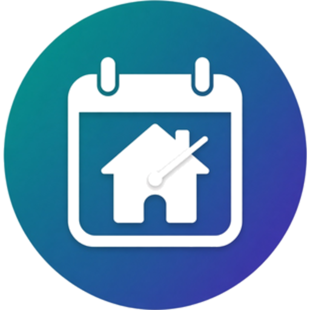

# Daily Routine

<p align="center">
  
</p>

**Room-by-room, safety-aware daily routines for Home Assistant.** Every room you already have in Home Assistant appears in the sidebar. Open a room, add a routine, done. Nothing to set up twice.

[](https://github.com/hacs/integration)
[](https://github.com/bisman-automations/ha-daily-routine/releases)

[](https://my.home-assistant.io/redirect/hacs_repository/?owner=bisman-automations&repository=ha-daily-routine&category=integration)

---

## What it does

- **Rooms from Home Assistant.** The sidebar shows every area (room) automatically, plus a **Whole house** card for routines that span the house. Create or rename rooms in *Settings → Areas & zones*, and they appear here.
- **Routines per room.** Curtains open at 07:00 in most rooms and at 08:00 in the bedroom: two routines. Lights in a room turn off once its motion sensor has been quiet for 10 minutes.
- **Whole-house routines.** Lights off when everyone has left and the house has been quiet for 15 minutes.
- **Triggers:** a set time, sunrise or sunset (with offset), everyone leaves or someone arrives at a place, or a chosen person leaves or arrives (Home, Work, or any other zone you've set up in Home Assistant), a room has been quiet, a sensor rising above or falling below a level (for example humidity), or manual only.
- **Daytime windows.** Any routine can be limited to hours, such as 07:00 to 22:00. Windows can cross midnight.
- **Humidity fan example.** A bathroom fan turns on when humidity goes above 60% and off again below 50%, but only between 07:00 and 22:00. The turn-off level creates a second routine named "(off)" that you can see and edit.
- **Safety first.** Unknown or unavailable people and sensors block a run. Conditions are checked again before every step.
- **Waits instead of giving up.** If a run is blocked (someone is still home, or motion is still happening), it waits until the conditions are met and runs once, up to midnight.
- **Runs as often as needed.** Presence and room triggers run every time they happen (for example, every time everyone leaves), not just once a day.
- **Dry run.** *Test* shows exactly what a routine would do right now, without touching any device.
- **Pause switch.** *Pause all routines* stops every automatic run. Manual runs still work.
- **Skips no-op steps.** A "lights off" step does nothing if the lights are already off.
- **Retries and catch-up.** Retry a failed step, and run a missed time-based routine if Home Assistant restarted a few minutes late.
- **Extra conditions.** Run only when the conditions hold: who is home or away, sensors quiet or active for a while, or an entity in a given state (for example guest mode is off).
- **Notifications** on run, skip, or failure (failures are on by default).
- **Status sensors** per routine (`idle`, `waiting`, `running`, `skipped`, `error`) for dashboards and automations.

---

## Install

### HACS

1. Click the badge above, or in HACS add `https://github.com/bisman-automations/ha-daily-routine` as a custom repository of type **Integration**.
2. Install **Daily Routine**, then restart Home Assistant.
3. *Settings → Devices & services → Add integration* → **Daily Routine**.
4. Open **Daily Routine** in the sidebar.

Requires Home Assistant 2026.9.0 or newer.

### Manual

Copy `custom_components/daily_routine` into your `config/custom_components/` folder, restart, and add the integration.

### Upgrading from 1.0.0

Your routines are moved into the new storage automatically on the first start. Old per-routine entries become empty entries titled *Daily Routine (migrated – safe to delete)*. Delete them when you are happy with the new setup.

---

## Using the sidebar

1. **Whole house** or a **room card** → **+ New routine**.
2. Pick a template (for example *Open curtains* or *Lights off when vacant*), or start blank.
3. Set **When**, **Do**, and **Options**. Use **Test (dry run)** to check it, then **Save**.

Room routines target the room itself, so lights or covers you add to that room later are included without editing the routine.

The sidebar has three tabs:

- **Rooms**: pick a room to see and add its routines.
- **Routines**: search every routine by name, room, device, trigger, or day.
- **Settings** (administrators only): which people routines can use, and where notifications also go.

Each routine card has **Run now**, **Edit**, **Duplicate**, **Enable/Disable**, and **Delete**. Under the routine's details, **Recent runs** lists its last five runs, including skips and failures and why they happened. Duplicate opens a copy you can change before saving. In the editor, **Linked device** picks the device the routine belongs to.

## Routines as devices

Each routine is its own service under the Daily Routine integration. It is linked to the device you picked (shown as *Connected via* on the routine's page). Routines without a device link to the **Daily Routine** device. Deleting a routine removes its service.

---

## Editing routines in Home Assistant

Every routine also appears under **Settings → Devices & services → Daily Routine**, as its own entry. Open one to change any of its settings: name, on or off, trigger, time, days, place, people, sensors, the quiet time, active hours, extra conditions, linked device, catch-up, retries, notifications and steps. Edits from either place show in both, and the same checks apply.

Steps and extra conditions are written as plain lines:

```
light.turn_off | light.kitchen_ceiling, light.hall
cover.open_cover | area:living_room
light.turn_on | light.hall | {"brightness": 128}
wait 30
```

- A step is `action | targets | extra settings`. Targets are entity ids separated by commas, or `area:` followed by an area id. Extra settings are optional JSON. `wait` takes seconds, or `00:00:30`.
- Conditions are one per line, in the **Extra conditions** list. There are three kinds:
  - `presence everyone away | person.sam, person.alex | zone.home`: everyone listed is away from the place. Use `presence anyone in | person.sam | zone.work` for "at least one person is at Work". `everyone` or `anyone`, then `in` or `away`, then the people and the place.
  - `sensors quiet 10 | binary_sensor.hall_motion`: the sensors have been off for 10 minutes. Use `sensors active 5 | ...` for "one of these has been on within the last 5 minutes".
  - `input_boolean.guest_mode = off`: an entity is in a given state, for example `lock.front_door = unlocked`.
- Every condition in the list has to hold for the routine to run. With more than one, choose **all** or **any one** above the list.
- Routines saved before this change convert on load. "Only when everyone is away" becomes a who-is-away condition, and "Only when the sensors have been quiet" becomes a quiet-sensors condition. Check any routine that set "any one" with those checkboxes, because the converted conditions now count toward that choice.

Deleting an entry deletes its routine.

## Backup

On **Settings** in the sidebar (administrators only), **Export routines** saves every routine to a file. **Import routines** loads a file saved earlier. A routine in the file replaces the one with the same id. Routines that fail the checks are listed and the others still load. Turn-off routines are rebuilt from the routine they belong to, so they are not exported. A linked device that isn't on this Home Assistant is linked to the Daily Routine device instead.

## Diagnostics

On **Settings → Devices & services → Daily Routine**, choose *Download diagnostics* to get the routines, their status and the settings, for reporting a problem. Phone names and hidden profiles are redacted. Routines still contain entity ids, so check the file before posting it publicly.

## Settings

- **People in routines.** Turn off the profiles that aren't people, such as a shared display, so they don't appear when you build a routine. A routine that already uses someone keeps them.
- **Notifications.** Routine runs, skips and failures always appear in Home Assistant's notifications. Tick any phones or devices, shown by name, to send them there too. Any number can be selected.

## Routine reference

| Field | Meaning |
|-------|---------|
| Trigger | `time`, `sunrise`, `sunset`, `everyone_leaves`, `someone_arrives`, `person_leaves`, `person_arrives`, `room_clear`, `value_above`, `value_below`, or `manual` |
| Place | For leave and arrive triggers: the zone that counts, such as Home or Work. Defaults to Home |
| Sensor and level | For value triggers: a numeric sensor, the level it must cross, and for "above" an optional level to turn back off |
| Only run between | Optional start and end time. Outside these hours the routine does nothing. Windows can cross midnight |
| Time / offset | For time and sun triggers (offset in minutes, negative is before) |
| Days | Which days it may run |
| People | For presence triggers. Only people with location tracking can be checked |
| Sensors and quiet for | For the room is quiet trigger: the motion or occupancy sensors that must stay off for N minutes. Motion restarts the count |
| Extra conditions | A list of conditions that must hold. Each one is **who is home or away** (everyone or anyone, at or away from a place), **sensors quiet or active** for N minutes, or **a device's state**. With more than one, choose whether **all** of them must hold or **any one** is enough. Each line is described under Editing routines in Home Assistant |
| Run every time | Run on every trigger, not once a day (default on for presence and room triggers) |
| Skip steps already done | Skip a step whose devices are already in the target state (default on) |
| Catch up | If Home Assistant was restarting when a time routine was due, still run it once it is back, within a window of up to 3 hours ("Don't run it late" turns this off). Home Assistant gets about 30 seconds to load, then the routine runs as soon as it can. If a condition blocks it, it is retried each minute until the window closes |
| Retry | Retry a failed step up to 3 times |
| Steps | Actions chosen by name, such as "Turn off lights" (with a room, specific devices, or no target), or any service under "Other (advanced)", plus waits |
| Notify | On run, on skip, on failure |

### Trigger notes

- **Room is quiet** runs once each time the room's sensors have been quiet for the chosen minutes. It does not fire just because Home Assistant restarted in a quiet room.
- **Everyone leaves / someone arrives** fire on the change itself. With sensors selected, they wait until the room is quiet. "Everyone leaves Work" means every person has left that zone, and "someone arrives at Work" means the first person to reach it after everyone had left. A person who is at another place counts as away from Home.
- **Person leaves / person arrives** fire when one of the chosen people goes from the place to somewhere else, or from elsewhere to the place. Other people's moves don't count, and a person whose state is unknown or unavailable never triggers it.
- **Above / below a level** fire when the sensor crosses the level, not on every reading. Staying above it does not run the routine again. The turn-off level for "above" creates a companion routine named "(off)" that runs when the sensor drops below that level.
- **Outside the window** a crossing is ignored. The routine does not catch up when the window opens. It runs at the next crossing inside the window.

---

## Services

| Service | Description |
|---------|-------------|
| `daily_routine.run_routine` | Run a routine by id. Conditions still apply; the once-a-day rule does not. |
| `daily_routine.reload_routines` | Restart all schedules and watchers. |

```yaml
service: daily_routine.run_routine
data:
  routine_id: kitchen_lights_off
```

Entities:

- `switch.pause_all_routines`: on = all automatic routines paused.
- Routine status sensors: one per routine, on that routine's service device. The entity id is set by Home Assistant. Routines created on Home Assistant 2026.10 or later include the device name in it (for example `sensor.daily_routine_<routine>_status`). Upgraded routines keep their existing id. The state is `idle`, `waiting`, `running`, `skipped`, or `error`. Attributes include `last_run`, `last_result`, `next_run`, `block_reason`, `waiting`, and `repeat`.

## Events

- `daily_routine_routine_started`
- `daily_routine_routine_finished` (`result`: `success` or a failure reason)
- `daily_routine_routine_skipped` (`result`: `disabled`, `paused`, `already_ran_today`, `conditions_not_met`, `waiting:<reason>`, …)

Every event includes `routine_id` and `name`.

---

## Safety behaviour

- Missing, `unknown`, or `unavailable` people or sensors → the condition fails and the routine does not run.
- Everyone away means every selected person is exactly `not_home`.
- Sensors are quiet only when every selected sensor is exactly `off`. Any motion restarts the quiet timer.
- The quiet timer starts when Home Assistant sees the sensors go quiet. It is not stored, so a restart starts it again from the live state.
- Conditions are checked again before every step. If they stop holding, the rest of the routine stops.
- Waiting routines expire at midnight and are reported as skipped.
- There is **no force or bypass** option, including for manual runs.
- Pausing and resuming takes effect immediately.
- This is **not a security system**. Test with harmless steps before using locks or alarms.

---

## Development

- Routines live in Home Assistant storage (`.storage/daily_routine.routines`). The sidebar talks to them through websocket commands in `panel.py`.
- Pure routine validation is in `routines.py`. Scheduling and execution are in `coordinator.py`. Room discovery uses the area, device, and entity registries.
- Tests:
  - `pip install -r requirements_test.txt`
  - `pytest` (Home Assistant test harness, covering scheduling, safety, migration, and setup)
  - `node --test tests/test_panel_frontend.mjs` (sidebar panel smoke tests)
- Version lives in `custom_components/daily_routine/manifest.json`. See `CHANGELOG.md`.

---

## Licence and feedback

MIT licensed (see [LICENSE](LICENSE)). Issues and pull requests welcome: https://github.com/bisman-automations/ha-daily-routine/issues
